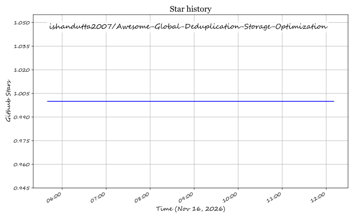

  

# 🚀 Awesome Global Deduplication & Storage Optimization

  
  
  
  
  
  
  
  

> 📚 A curated directory of enterprise SaaS platforms, cloud services, and open-source software for **Global Deduplication, Storage Optimization, Data Tiering, and Intelligent Data Reduction**.

📅 **Last updated: March 2026**

---

Enterprise data volumes are expanding exponentially—driven by unstructured media, database archives, and multi-terabyte AI/ML model checkpoints. Managing secondary storage and long-term retention requires advanced **block- and file-level deduplication (inline & post-process)**, **content-defined chunking (CDC)**, and **automated lifecycle storage tiering** from high-performance NVMe down to deep-archive tape and object storage.

This repository tracks the leading commercial SaaS platforms and high-performance open-source GitHub projects designed to maximize storage efficiency and eliminate unnecessary cloud egress and consumption costs.

---

## 📑 Table of Contents
- [📊 Sector Overview & Market Dynamics](#-sector-overview--market-dynamics)
- [☁️ SaaS/Hosted Platforms](#️-saashosted-platforms)
- [💻 Open-Source GitHub Projects](#-open-source-github-projects)
- [📖 Algorithmic Foundations & Literature](#-algorithmic-foundations--literature)
- [📈 Star History](#-star-history)
- [💖 Support & Community](#-support--community)
- [🤝 How to Contribute](#-how-to-contribute)
- [⚖️ Disclaimer](#️-disclaimer)

---

## 📊 Sector Overview & Market Dynamics

The global data deduplication and storage optimization market is valued at approximately **$14.2 billion** and projected to exceed **$33.7 billion by 2032** (expanding at a ~10.1% CAGR), set against a broader data storage and management ecosystem approaching **$300+ billion**. The sector is **moderately fragmented**: primary hyper-scalers (Microsoft Azure, AWS) and legacy infrastructure titans (Dell Technologies, NetApp, Pure Storage) dominate underlying block/object tiers and enterprise hardware appliances, while specialized scale-ups (Cohesity, Druva, Komprise, Wasabi) command high-margin, hybrid cloud data management, global deduplication vaults, and independent multi-cloud tiering layers.

---

## ☁️ SaaS/Hosted Platforms

The following SaaS and managed cloud platforms deliver automated data reduction, global cross-workload deduplication, and policy-driven tiering. Products are sorted descending by company size (market capitalization or latest enterprise valuation).

| Product | Company Size (Market Cap / Valuation) | Description | Starting Pricing (Specific Tier) | Free Tier / Trial Limits |
|---|---|---|---|---|
| **[Azure Storage Lifecycle Management](https://azure.microsoft.com/en-us/products/storage/blobs/)** | **$3.89 Trillion** (Market Cap) | Automated policy engine managing object transitions between Hot, Cool, Cold, and Archive storage tiers. Rule evaluation and file deletion transactions are free of charge. | Free management rules; Hot tier starts at **$0.018/GB/month** ($18.00/TB/month) down to Archive at **$0.00099/GB/month** ($0.99/TB/month) + tier transition API costs ($0.05 per 10k transactions). | **Free for 12 months**: 5 GB LRS-Hot Blob storage + 20,000 read and 10,000 write operations/month. |
| **[AWS S3 Storage Lens](https://aws.amazon.com/s3/storage-lens/)** | **$2.88 Trillion** (Market Cap) | Centralized, organization-wide analytics and anomaly detection for Amazon S3, delivering cost-optimization metrics, bucket prefix visibility, and policy recommendations. | Free default tier; Advanced Metrics & Recommendations starts at **$0.20 per million objects monitored/month** (first 25B objects, dropping to $0.16/M above 25B). | **Free plan forever**: Pre-configured default dashboard monitoring 28 core cost/usage metrics with 14 days of historical retention. |
| **[Dell PowerStore Deduplication (APEX)](https://www.dell.com/)** | **$238 Billion** (Market Cap) | Enterprise block, file, and vVol storage array featuring inline hardware-assisted deduplication and compression with a guaranteed 4:1 data reduction ratio. | APEX Data Storage Services subscriptions start at roughly **$0.20/GB/month** (~$200/TB/month) based on 1–3 year commitments and 50 TB minimum usable capacity. | **No free tier**; guided Proof of Concept (PoC) / evaluation appliance provisioned upon sales qualification (typically 30–60 days). |
| **[NetApp Cloud Tiering](https://www.netapp.com/)** | **$36.8 Billion** (Market Cap) | FabricPool-powered automated tiering that offloads inactive blocks from on-premises ONTAP storage or Cloud Volumes ONTAP to Amazon S3, Azure Blob, or Google Cloud. | Pay-As-You-Go starts at **$0.05 per GB tiered/month** (**$50.00/TB/month**); annual committed subscriptions start at ~$0.033 to $0.04/GB/month (~$33–$40/TB/month). Tiering to local StorageGRID is free. | **30-day free trial** for the first ONTAP cluster; Cloud Volumes ONTAP includes a Freemium tier supporting up to **500 GiB** total capacity free forever. |
| **[Pure Storage FlashBlade](https://www.purestorage.com/)** | **$28.8 Billion** (Market Cap) | Unified fast file and object (UFFO) flash architecture with always-on, inline byte-level deduplication, compression, and thin provisioning across high-concurrency workloads. | Evergreen//One Storage-as-a-Service catalog pricing starts at **$0.085 to $0.118 per GiB/month** (~$85–$118/TB/month) with a 100 TiB reserve commitment on 1-year terms. | **No free tier**; enterprise Proof of Concept (PoC) trial units available via certified channel partners upon approval. |
| **[Cohesity SmartFiles](https://www.cohesity.com/)** | **$7.0 Billion** (Valuation) | Software-defined scale-out file and object platform with global sliding-window deduplication and compression for unstructured data consolidation and archive tiering. | Enterprise software subscription licenses benchmark at **$150 to $400 per Back-End TB (BETB) annually** (~$12.50 to $33.33/TB/month) depending on volume commitments. | **30-day free trial** of Cohesity Cloud Data Services; custom sandbox PoC arranged through enterprise sales. |
| **[Druva](https://www.druva.com/)** | **$2.0 Billion** (Valuation) | 100% SaaS cloud data resiliency and protection platform featuring source-side and global cloud deduplication, zero-egress restores, and multi-cloud tiering. | Enterprise Server protection starts at **$170 to $220 per credit/month** (1 Credit = 1 TB of compressed, deduplicated cloud storage, billed on post-dedupe volume). | **30-day free trial** with full access to SaaS backup policies, cloud vaulting, and deduplication reporting (extendable up to 60 days via sales). |
| **[Wasabi Cloud Storage](https://wasabi.com/)** | **$1.8 Billion** (Valuation) | High-performance, S3-compliant hot cloud object storage with zero egress fees and no API request charges, frequently used as an immutable off-site deduplication target. | Flat rate of **$7.99 per TB/month** ($0.0078/GB/month) with a 1 TB minimum storage commitment. | **30-day free trial** up to **1 TB (1,000 GB)** of storage with zero charges (corporate domain email required). |
| **[Komprise Intelligent Data Management](https://www.komprise.com/)** | **$85 Million** (Valuation / Raised) | Analytics-driven unstructured data management that identifies cold files across multi-vendor NAS/cloud and transparently tiers them via dynamic symbolic links (stubs). | Microsoft Azure & AWS Marketplace packaged tiers start at **$61,600/year for 250 TB** (~$20.53/TB/month), scaling to **$154,000/year for 1 PB** (~$12.83/TB/month). | **No free plan**; complimentary unstructured data profiling assessment and customized 30-day guided PoC trial via sales. |

---

## 💻 Open-Source GitHub Projects

Community-developed storage management engines, deduplicating file systems, and archival backup tools. Repositories are ranked descending by GitHub_Stars_Count. Each Stars_Badge links directly to the project's stargazers community.

| Project | Stars_Badge | Description | Primary Languages / Architecture |
|---|---|---|---|
| **[Rclone](https://github.com/rclone/rclone)** |  | The quintessential cloud storage sync tool ("rsync for cloud storage"). Supports over 70 cloud storage providers with automated multi-tier transfers, chunker backends, client-side deduplication utilities (`rclone dedupe`), and bandwidth-optimized synchronizations. | Go / CLI & Mount Daemon |
| **[Restic](https://github.com/restic/restic)** |  | Secure, fast, and robust backup program utilizing content-defined chunking (CDC) via Rabin fingerprints to deliver global, block-level deduplication across historical snapshots. Encrypted with AES-256 in counter mode. | Go / Content-Defined Chunking |
| **[Duplicati](https://github.com/duplicati/duplicati)** |  | Client-side backup engine for cloud storage targets featuring block-based incremental backups, adaptive deduplication, AES-256 encryption, and built-in web configuration interface. | C# / .NET / Web UI |
| **[Kopia](https://github.com/kopia/kopia)** |  | Next-generation fast and secure open-source backup tool featuring content-addressable storage, end-to-end zero-knowledge encryption, and high-throughput content-defined deduplication with native GUI and CLI tools. | Go / FastCDC / BLAKE3 |
| **[BorgBackup](https://github.com/borgbackup/borg)** |  | Deduplicating archiver with authenticated encryption. Employs content-defined chunking where each block is indexed via HMAC-SHA256, ensuring identical chunks across different backups and machines are stored only once. | Python & C / Cython |
| **[OpenZFS](https://github.com/openzfs/zfs)** |  | Advanced file system and volume manager with native inline block-level deduplication (DDT - Deduplication Table), transparent dataset compression (Zstd, LZ4), adaptive replacement cache (ARC), and snapshot cloning. | C / Kernel File System |
| **[Duplicacy](https://github.com/gilbertchen/duplicacy)** |  | Lock-free deduplication cloud backup tool based on variable-size chunking. Multiple clients can back up simultaneously to the same remote storage without synchronization locks. | Go / Lock-Free CDC |
| **[Opendedup SDFS](https://github.com/opendedup/sdfs)** |  | Enterprise-grade deduplicating distributed file system engineered for virtual environments and structured backups. Features inline variable-block deduplication, cloud tiering to S3/Azure, and 4:1 to 20:1 data reduction ratios. | Java & C / FUSE & Distributed FS |
| **[HuskHoard](https://github.com/huskhoard/huskhoard)** |  | Comprehensive Linux data tiering archive that transparently offloads cold data to S3, HDD, or physical LTO tape while retaining instant local stub files. Utilizes Linux `fanotify` kernel APIs for zero-overhead blocking and retrieval. | Go / Zstd / BLAKE3 / SCSI Tape |
| **[TierFS](https://github.com/mikey-austin/tierfs)** |  | FUSE-based multi-tier file system supporting up to 5 progressive tiers (SSD → NAS/SFTP → S3/MinIO → Backblaze → null discard). Features digest-verified asynchronous replication, zero-copy local reads, and Prometheus telemetry. | Go / FUSE / Multi-Tier Storage |
| **[NRA (Neural Ready Archive)](https://github.com/zevatov/NRA)** |  | High-speed archive format optimized for massive machine learning datasets. Integrates content-defined chunking (CDC) deduplication (4–8x savings), B+ Tree random access, and zero-download streaming for PyTorch/HuggingFace datasets. | Rust / FastCDC / Zstd / AES-256 |

---

## 📖 Algorithmic Foundations & Literature

For engineers, systems researchers, and storage architects studying data reduction algorithms (Content-Defined Chunking, sliding-window hashing, fingerprint indexing, and garbage collection):

| Resource | Stars_Badge | Description |
|---|---|---|
| **[awesome_storage_papers](https://github.com/yzr95924/awesome_storage_papers)** |  | Curated catalog of peer-reviewed computer science literature covering CDC chunking algorithms (FastCDC, Gear, RapidCDC), index cache management, secondary storage garbage collection, and NVM-accelerated deduplication. |

---

## 📈 Star History

---

## 💖 Support & Community

Thank you so much for exploring this repository! If this curated list helped you identify storage cost-savings, explore deduplication architectures, or select tiering tools for your infrastructure:

- ⭐ **Star this repository** to help others discover it and follow along with updates.
- 🍴 **Fork and share** it with fellow systems architects, DevOps engineers, and storage admins.
- ☕ **Buy me a coffee / Sponsor**: If you find continuous value in this work and want to support ongoing curation and benchmarks, consider becoming a sponsor via the [GitHub Sponsor Dashboard](https://github.com/sponsors/ishandutta2007).

Your support keeps open-source and independent benchmarking thriving!

---

## 🤝 How to Contribute

We welcome additions, updates, and benchmark reports from the community!

1. **Fork** this repository.
2. **Add or update** entries in `README.md` maintaining table formatting, verified pricing data, and social Stars_Badges linked to stargazers.
3. Keep product and software descriptions objective, concise, and focused on storage efficiency, tiering mechanisms, or deduplication algorithms.
4. **Submit a Pull Request** detailing your changes.

---

## ⚖️ Disclaimer

- This list is independently curated for educational and architectural reference purposes.
- Always test and benchmark deduplication ratios and retrieval latency against your organization's specific workloads. Write-heavy relational database engines (e.g., PostgreSQL, SQL Server, Oracle) and encrypted blobs typically achieve low deduplication ratios, whereas virtual machine disks, container images, and software deployment shares frequently achieve 70–90% reduction.
- All pricing, corporate market caps, and free trial terms are subject to change by their respective vendors. Verify current terms on official provider portals before signing enterprise agreements.

## ⭐ Star History

<a href="https://star-history.com/#ishandutta2007/Awesome-Global-Deduplication-Storage-Optimization&Timeline" align="center">
  <picture>
    <source media="(prefers-color-scheme: dark)" srcset="assets/ishandutta2007_Awesome-Global-Deduplication-Storage-Optimization_growth.svg">
    
  </picture>
</a>
